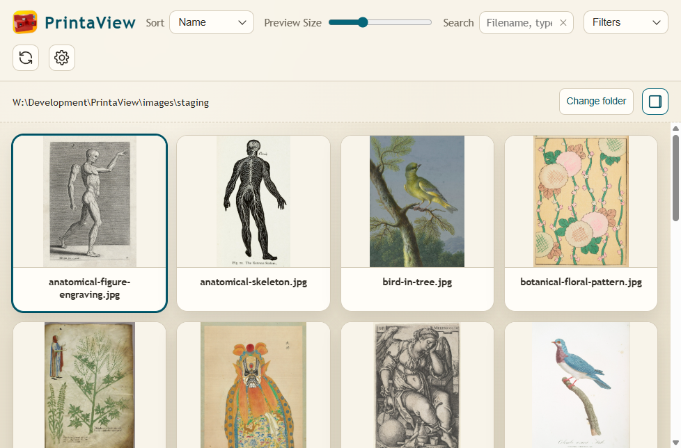
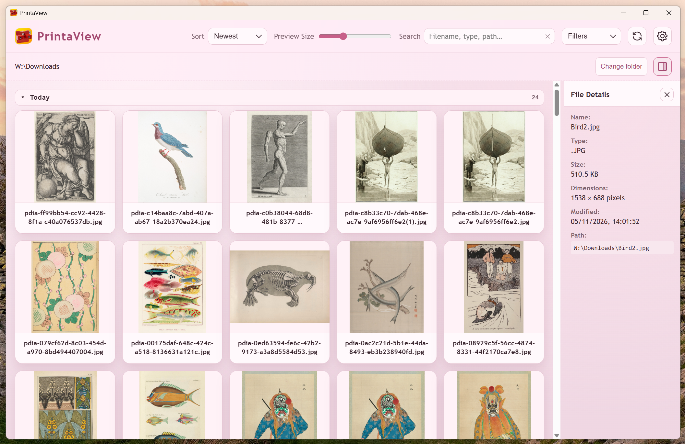
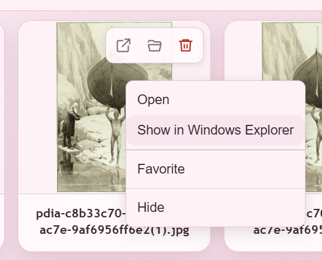
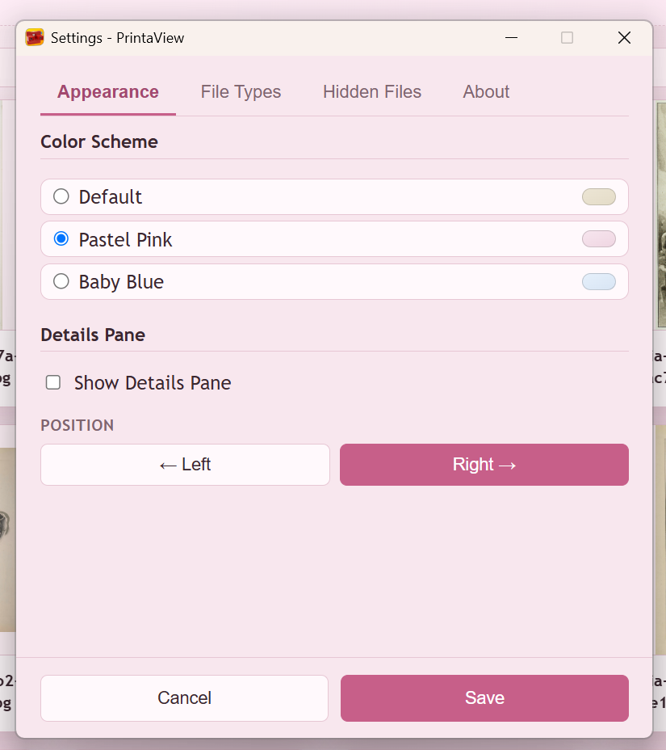
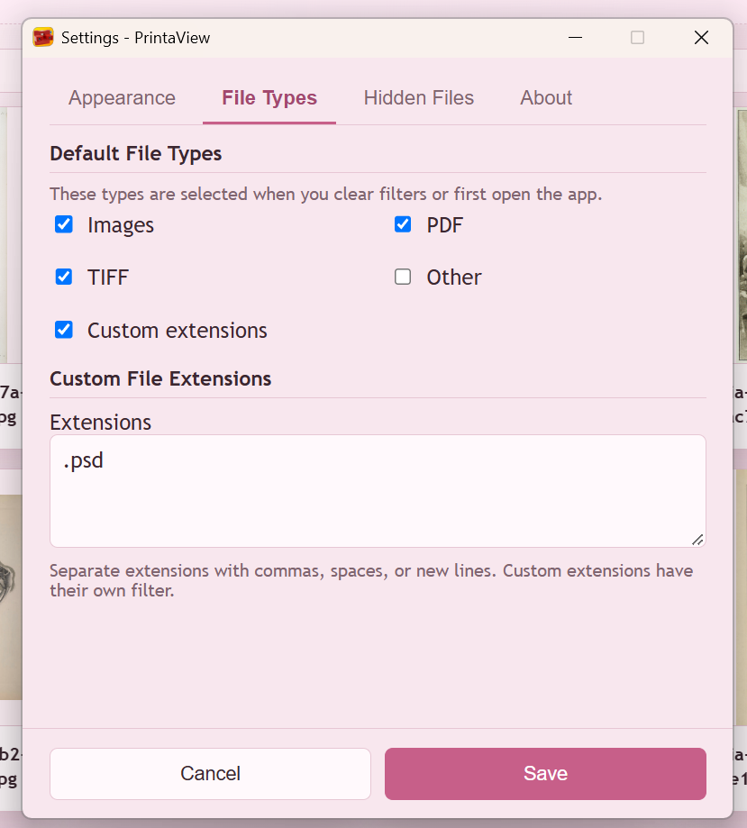
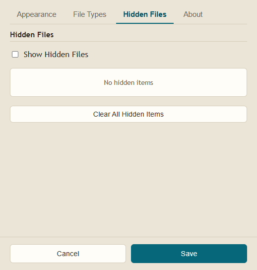
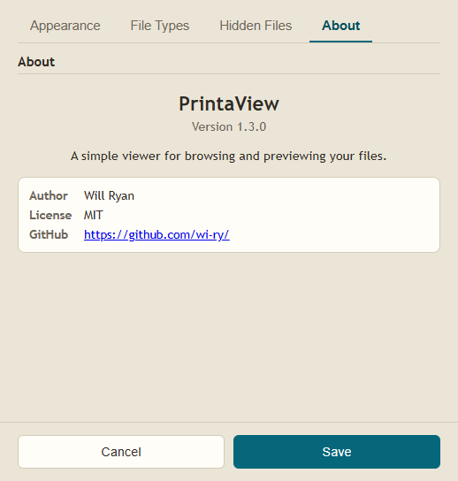

<h1>
  
  PrintaView
</h1>

PrintaView is a standalone Windows desktop app for browsing and previewing files from your Downloads folder in one unified view (including all sub-folders).




*Main application view with and without the details pane*



*Right-click context menu with hide and favourite actions*






*The four settings tabs*

Refresh these screenshots from the bundled sample images in `images/staging/` with:

```sh
npm run screenshots
```

To use a different demo folder, pass its path:

```sh
npm run screenshots -- "path/to/PrintaView Demo Images"
```


## Features

- Recursive browsing of a selected root folder, defaulting to `Downloads` and allowing quick folder changes.
- Preview-first browsing for common file types, including images (`png`, `jpg`, `jpeg`, `bmp`, `gif`, `webp`, `tif`, `tiff`, `ico`, `psd`) and `pdf`.
- Fast thumbnail generation for images and PDF cover pages, with page counts for multi-page PDFs.
- Generic preview tiles for supported non-image file types such as `docx` and `pptx`.
- Search and filtering by file type, favourites, modification date, and file size.
- Sort options for `Newest`, `Oldest`, `Name`, and `Type`, with type-grouped browsing.
- Favourites workflow with a simple `All` / `Favourites` toggle and per-item favourite actions.
- Hidden file management that stays inside the app instead of changing the Windows hidden attribute; includes `Show Hidden Files`, per-item unhide, and clear-all support.
- Duplicate review that compares matching files side by side and lets you preview, open, reveal, or delete them.
- Optional details pane with metadata, adjustable preview size, and configurable left/right placement.
- Keyboard and mouse-friendly actions for opening files, revealing them in Explorer, and moving them to the Recycle Bin.
- Settings for theme selection (`Default`, `Pastel Pink`, `Baby Blue`), default file type filters, custom extensions, and per-user app preferences.

## Development

1. Install dependencies:

```powershell
npm install
```

2. Run the app:

```powershell
npm start
```

3. Run tests (Electron UI tests are headless by default):

```powershell
npm run test:all
```

To show the app windows while debugging UI tests, set `PRINTAVIEW_TEST_HEADED=1` before running `npm run test:e2e` or `npm run test:packaged`.

## Build Standalone Portable EXE (Windows)

```powershell
npm run build:win
```

Build output is written to the `release` folder as a portable executable that can be run from anywhere.

## Microsoft Store Release

After the `Test on Main` workflow succeeds, semantic-release analyses commits on `main`. When they require a release, it automatically updates the package version, creates a `vX.Y.Z` tag and a GitHub release titled `PrintaView vX.Y.Z`, then builds an unsigned MSIX and portable EXE. The portable EXE is attached to the GitHub release, while the MSIX is submitted directly to Microsoft Store and is not published as a release download. The Store signs the package; no signing certificate is needed.

Before the first release:

1. Create and reserve the PrintaView product in Partner Center. Set up its Store listing and pricing, then obtain the product identity values.
2. In the GitHub repository, add these Actions **variables** using the values from Partner Center's Product identity page:
   - `MSIX_IDENTITY_NAME`
   - `MSIX_PUBLISHER`
   - `MSIX_PUBLISHER_DISPLAY_NAME`
3. Add these Actions **secrets** for the Microsoft Store CLI service principal and product:
   - `STORE_ID`
   - `TENANT_ID`
   - `SELLER_ID`
   - `CLIENT_ID`
   - `SECRET_VALUE` (the service principal client secret)
4. Ensure the service principal has permission to manage the PrintaView product in Partner Center.

The workflow commits the calculated version to `package.json` and `package-lock.json`. The MSIX version is derived from that release version and converted to the four-part format required by Windows.

To build the unsigned package locally after installing dependencies:

```powershell
npm run build:win
npx electron-builder --win dir
.github\scripts\package-msix.ps1 -Version (node -p "require('./package.json').version")
```

Set the three `MSIX_*` environment variables to the Partner Center identity values when producing a package intended for Store submission.

## Automatic Versioning and Releases (CI/CD)

Releases are driven by [Conventional Commits](https://www.conventionalcommits.org/) merged to `main`:

- `fix: ...` creates a patch release (for example, `1.0.5` → `1.0.6`).
- `feat: ...` creates a minor release (for example, `1.0.5` → `1.1.0`).
- Add `!` after the type or include `BREAKING CHANGE:` in the commit body to create a major release.
- Other commit types that do not indicate a feature, fix, or breaking change do not trigger a release.

Pull request titles and commit messages are checked for Conventional Commit formatting. Use a release-triggering title such as `fix: correct PDF preview` or `feat: add folder filtering` when the change should ship. When CI succeeds on `main`, semantic-release updates `package.json` and `package-lock.json`, creates the version tag and GitHub release, and triggers the Windows packaging and Store submission job. The GitHub release includes the portable EXE; the unsigned MSIX is submitted directly to Microsoft Store only. No manual version bump or tag is needed. See [.github/workflows/conventional-commits.yml](.github/workflows/conventional-commits.yml), [.github/workflows/release.yml](.github/workflows/release.yml), and [.releaserc.json](.releaserc.json).
